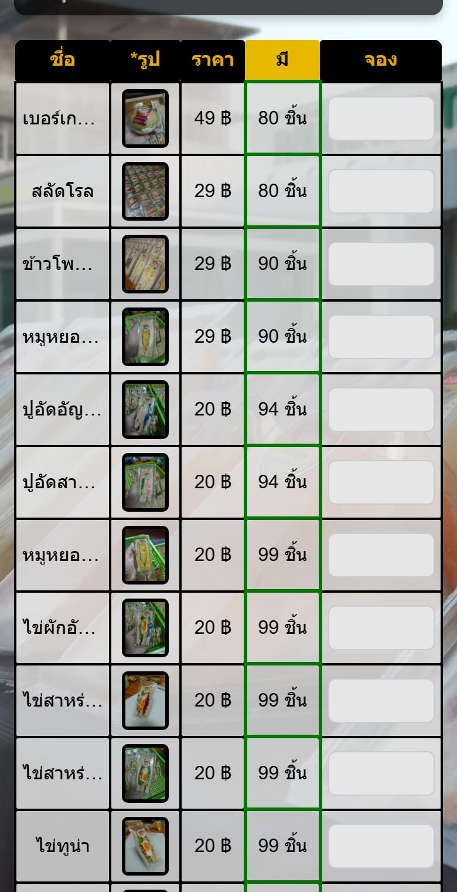
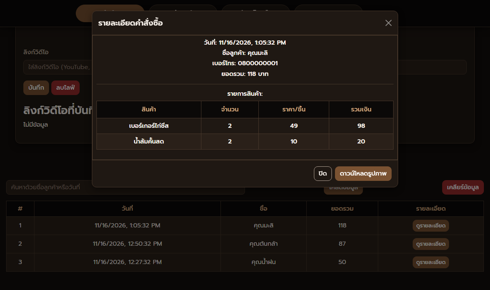
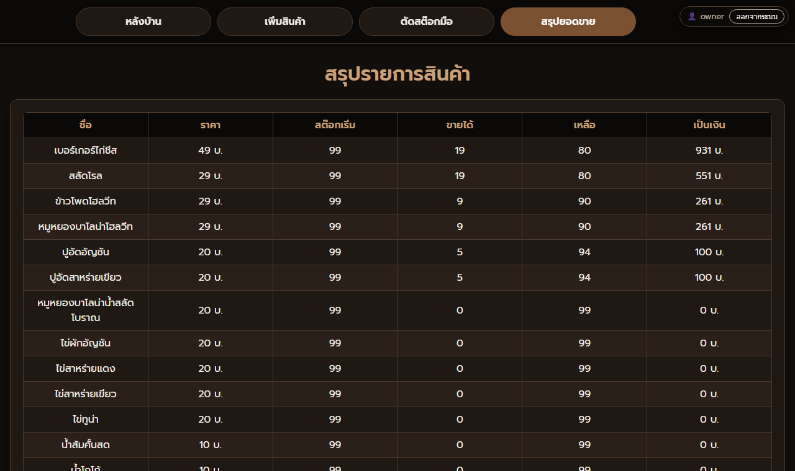
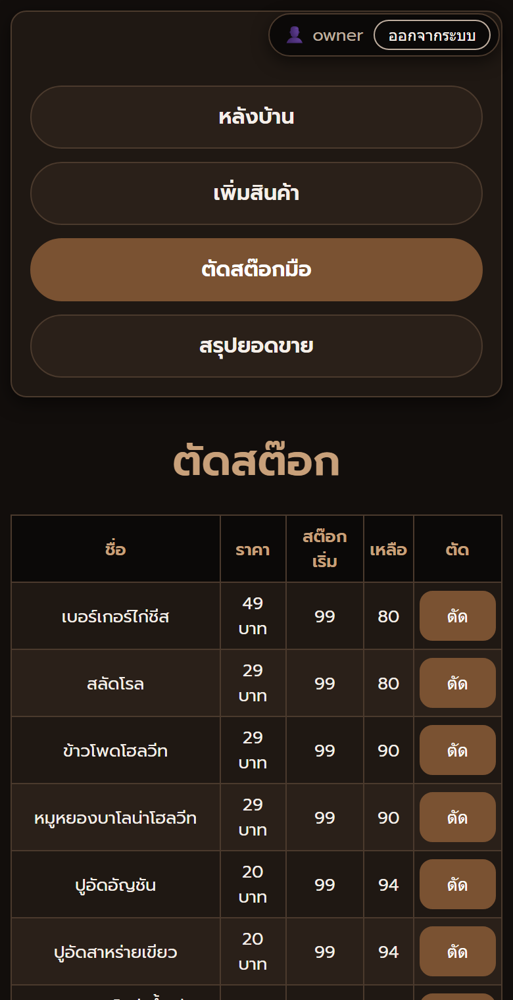
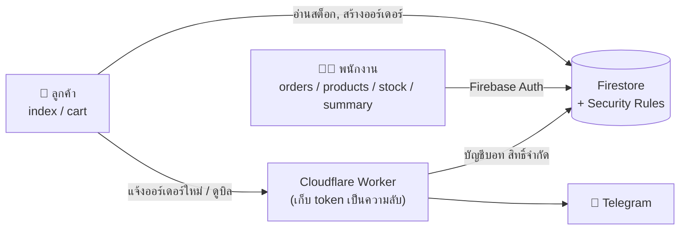

<h1 align="center">🥪 Order-in-Store <sub>(Faa Homemade)</sub></h1>

<p align="center">
  ระบบสั่งแซนวิชออนไลน์ + ขายหน้าร้าน + ตัดสต็อกแบบเรียลไทม์ ที่ใช้งานจริงในร้านของผมเอง (2022–2025)<br>
  <i>Real-time sandwich ordering, point-of-sale and shared stock, used in my own shop (2022–2025).</i>
</p>

<p align="center">
  
  
  
  
</p>

<p align="center">
  <a href="https://jojutjan.web.app"><b>🌐 jojutjan.web.app</b></a>
  &nbsp;·&nbsp;
  <a href="#english">English ↓</a>
</p>

<p align="center">
  
  &nbsp;
  
</p>

---

## 🇹🇭 ภาษาไทย

### ที่มา
ผมเปิดร้านแซนวิชโฮมเมด **Faa Homemade** และเขียนระบบนี้ใช้เองในร้าน ปัญหาเดิมคือ ลูกค้าสั่งผ่านแชท ขายหน้าร้านก็จดมือ **สต็อกสองทางไม่ตรงกัน** และต้องนั่งรวมยอดขายเองทุกวัน ระบบนี้ทำให้ทุกช่องทาง**ตัดสต็อกจากที่เดียวกันแบบเรียลไทม์** และมีแจ้งเตือนออร์เดอร์เข้ามือถือ

### ขั้นตอนการทำงานของร้าน
```
เพิ่มสินค้า ──▶ สต็อกกลาง (Firestore) ◀──┬── ขายหน้าร้าน / ตัดสต็อกมือ (พนักงาน)
                                         └── ลูกค้าสั่งออนไลน์ (หน้าร้าน → ตะกร้า)
                                                    ├──▶ 📱 แจ้งเตือน Telegram (ผ่าน Cloudflare Worker)
                                                    └──▶ หน้าจัดการออร์เดอร์ (อัปเดตทันที)
สรุปยอดขาย ──▶ บันทึกเป็นรูป ส่งให้ฝ่ายการเงินซื้อวัตถุดิบ
```

### ฟีเจอร์
**ลูกค้า (ไม่ต้องล็อกอิน)**
- ดูสินค้า รูป ราคา และ**จำนวนคงเหลือแบบเรียลไทม์** (กรอบสีบอกสถานะ: เขียว/เหลือง/แดง)
- ใส่ตะกร้าและสั่งซื้อ ระบบกันสั่งเกินสต็อก
- "ดูบิลของคุณ" ด้วยเบอร์โทร (ชื่อและเบอร์ในผลลัพธ์ถูกปิดบางส่วน)

**พนักงาน (ต้องล็อกอิน)**
| หน้า | ใช้ทำอะไร |
|---|---|
| `orders.html` | ออร์เดอร์เข้าแบบเรียลไทม์ ดูรายละเอียด บันทึกเป็นรูป ตั้งลิงก์ไลฟ์สด |
| `products.html` | เพิ่ม/แก้รายการสินค้า จำนวน ราคา และรูป |
| `stock.html` | ตัดสต็อกมือเมื่อขายหน้าร้าน พร้อมบันทึกประวัติ |
| `summary.html` | สรุปยอดขาย หักค่าแรง/ค่าฝาก และบันทึกเป็นรูปภาพ |

<p align="center">
  
  &nbsp;
  
</p>

### สถาปัตยกรรม


### งานด้านความปลอดภัยที่ผมแก้ (ทบทวนโค้ดเก่าของตัวเอง)
เวอร์ชันแรกใช้งานได้ แต่พอกลับมาตรวจอย่างจริงจังก็พบช่องโหว่หลายจุด จึงแก้ทีละเรื่องและทดสอบทุกขั้นก่อนขึ้นเว็บจริง

| ปัญหาเดิม | วิธีแก้ |
|---|---|
| token ของ Telegram bot อยู่ในหน้าเว็บ ใครเปิดดูโค้ดก็เอาไปใช้ได้ | revoke token เดิม แล้วย้ายการส่งไปไว้ที่ **Cloudflare Worker** (ฝั่งเซิร์ฟเวอร์ ฟรี ไม่ต้องใช้บัตร) |
| ฐานข้อมูลเปิดให้ทุกคนอ่าน/เขียน รวมชื่อและเบอร์โทรลูกค้า (เสี่ยงผิด PDPA) | เขียน **Firestore Security Rules**: ลูกค้าสร้างออร์เดอร์ได้อย่างเดียวและข้อมูลต้องผ่านการตรวจ ส่วนออร์เดอร์และบันทึกอ่านได้เฉพาะพนักงาน |
| หน้าพนักงานไม่มีระบบล็อกอิน | **Firebase Auth** + รายชื่อพนักงาน `staff/{uid}` ที่แก้ได้จาก Console เท่านั้น (สมัครบัญชีเองก็ไม่ได้สิทธิ์) |
| ชื่อลูกค้าถูกใส่ลง `innerHTML` ตรงๆ (XSS) | `escapeHtml()` ครอบทุกจุดที่แสดงข้อมูล และรับเฉพาะลิงก์ `http/https` |
| Worker ต้องอ่านออร์เดอร์ | ใช้ **บัญชีบอทแบบสิทธิ์น้อยที่สุด**: อ่านออร์เดอร์และติ๊ก `notified` ได้ครั้งเดียว (กันส่งซ้ำและกันสแปม) |

ทุกกฎมีชุดทดสอบอัตโนมัติ **55 ข้อ** (`tests/`) ทั้งสิ่งที่ "ต้องทำได้" และ "ต้องถูกปฏิเสธ"

### โครงสร้างโปรเจกต์
```
public/              หน้าเว็บ (Firebase Hosting)
├─ index.html        หน้าร้าน          ├─ orders.html    จัดการออร์เดอร์
├─ cart.html         ตะกร้า/สั่งซื้อ     ├─ products.html  เพิ่มสินค้า
├─ login.html        ล็อกอินพนักงาน     ├─ stock.html     ตัดสต็อกมือ
├─ css/theme.css     ธีมกลาง           └─ summary.html   สรุปยอดขาย
└─ js/               firebase-config, staff-auth, escape-html, shop-api
worker/              Cloudflare Worker: แจ้งเตือน Telegram + ค้นบิล
firestore.rules      กฎความปลอดภัยของฐานข้อมูล
tests/               ชุดทดสอบกฎ (Firebase Emulator)
```

### วิธีรันและทดสอบ
**สิ่งที่ต้องมี:** Node.js 20+, Firebase CLI (`npm i -g firebase-tools`), Java 11+ (สำหรับ Emulator)

```bash
# ทดสอบกฎ Firestore (รันบน Emulator ในเครื่อง ไม่แตะฐานข้อมูลจริง)
cd tests && npm install && npm test

# เปิดเว็บในเครื่อง (หน้าเว็บยังเชื่อมฐานข้อมูลจริง ระวังการกดปุ่มที่แก้ข้อมูล)
firebase emulators:start --only hosting

# Worker: ตั้งความลับครั้งแรก แล้ว deploy
cd worker && npm install
npx wrangler secret put TELEGRAM_TOKEN      # และ TELEGRAM_CHAT_ID, BOT_EMAIL, BOT_PASSWORD
npx wrangler deploy
```

### สิ่งที่ได้เรียนรู้
- "ใช้งานได้" กับ "ปลอดภัย" ไม่ใช่เรื่องเดียวกัน: ความลับต้องอยู่ฝั่งเซิร์ฟเวอร์ และฐานข้อมูลต้องมีกฎที่ทดสอบได้
- แก้ระบบที่ใช้งานจริงต้องทำทีละขั้น: สำรองข้อมูลก่อน ทดสอบบน Emulator / Preview Channel แล้วค่อยขึ้นจริง
- ลดขนาดเว็บจาก ~307 MB เหลือ ~27 MB ด้วยการย่อรูปตามขนาดที่แสดงจริง

---

<a id="english"></a>

## 🇬🇧 English

### Background
I ran a small homemade sandwich shop, **Faa Homemade**, and built this system for it. Before, online orders came in through chat and walk-in sales were written by hand, so **the two stock counts never matched** and daily totals took manual work. Now every channel **deducts from one shared stock in real time**, and new orders alert my phone.

### Features
**Customers (no login):** live stock with colour-coded availability, cart with over-stock protection, and "view my bill" by phone number (results are partly masked).

**Staff (login required):** real-time order list with details and image export (`orders.html`), product editor (`products.html`), manual stock deduction with a log (`stock.html`), and a sales summary that exports as an image for the person handling money and supplies (`summary.html`).

### Architecture
See the diagram in the Thai section: static pages on Firebase Hosting, Firestore with security rules, Firebase Auth for staff, and a Cloudflare Worker that holds the Telegram token and reads Firestore through a least-privilege bot account.

### Security work (reviewing my own earlier code)
| Problem | Fix |
|---|---|
| Telegram bot token embedded in the page | Revoked it; alerts now go through a **Cloudflare Worker** that keeps the token as a secret (free tier, no credit card) |
| Database open to anyone, including customer names and phone numbers | **Firestore Security Rules**: customers may only create validated orders; orders and logs are staff-only |
| Staff pages had no login | **Firebase Auth** plus a console-managed `staff/{uid}` allowlist (self sign-up grants nothing) |
| Customer names inserted with `innerHTML` (XSS) | `escapeHtml()` on every rendered field; only `http/https` links accepted |
| The Worker needs to read orders | **Least-privilege bot account**: read orders, set `notified` once (prevents duplicate alerts and spam) |

The rules are covered by **55 automated tests** (`tests/`) for both what must be allowed and what must be denied.

### Run and test
Requirements: Node.js 20+, Firebase CLI, Java 11+ for the emulator.
```bash
cd tests && npm install && npm test          # rules tests on the local emulator
firebase emulators:start --only hosting      # serve the site locally (pages still use the real database)
cd worker && npx wrangler deploy             # after setting the four secrets with `wrangler secret put`
```

### What I learned
- Working is not the same as secure: secrets belong on a server, and data access needs rules you can test.
- Changing a live system safely means small steps: back up first, test on emulators and a preview channel, then release.
- Resizing images to their displayed size cut the site from ~307 MB to ~27 MB.

### Tech stack
HTML · CSS · JavaScript · Bootstrap 5 · Firebase (Firestore, Authentication, Hosting) · Cloudflare Workers · Telegram Bot API · html2canvas · Firebase Emulator Suite
